# 📊 NEXUS ERP: SALES & CRM INTEGRATION BLUEPRINT (V3.2 Locked)

This blueprint maps the proposed technical architecture, data flow, ledger entries, and visual layouts for the **Sales & CRM** module upgrade. It enforces **Multi-Tenant Scoping boundaries**, the **3-State Stock Lock**, **Double-Entry ledger accounting**, and **PSG V3.1 UI constraints**.

---

## 🏗️ 1. Module File Architecture & Key Entry Points

We will organize the CRM and Sales pipeline integrations under these primary source files:

```
src/
├── app/
│   └── (authenticated)/
│       └── sales/
│           └── page.tsx                      # Main Dashboard (CRM, QT, SO, AI Scoring)
├── components/
│   └── commerce/
│       ├── QuotationModal.tsx                # Itemized Quotations Editor (Unlocked)
│       └── SalesOrderModal.tsx               # Sales Order Manager (Draft to Confirmed)
├── lib/
│   ├── sales-service.ts                      # Transactional State Transitions (QT -> SO)
│   ├── stock-service.ts                      # 3-State Stock Lock & WAC Engine
│   └── financial-service.ts                  # Double-Entry GL Ledger generator
└── services/
    ├── crm.service.ts                        # Customer profile management (Multi-tenant)
    └── audit.service.ts                      # Immutable log triggers
```

---

## 🔒 2. Multi-Tenancy Scoping & Soft Delete Enforcements

To protect tenant isolation, every operational query is governed by the active operator's context.

### A. Read/Write Query Rules
All data access in the services (`sales-service.ts`, `crm.service.ts`, `stock-service.ts`) strictly includes the following filters:
```typescript
const q = query(
  collection(db, "products"),
  where("companyId", "==", activeCompanyId),
  where("isDeleted", "==", false)
);
```

### B. Logical Deletion (Soft Delete)
Calling a delete operation on customers or documents changes the logical flag to `isDeleted: true` instead of calling `deleteDoc()`. Admin permissions are verified securely:
```typescript
if (userRole !== 'ADMIN' && userRole !== 'SUPERADMIN') {
  throw new Error("ACCESS_DENIED: Administrative permissions are required for deletions");
}
```

---

## 📦 3. Commercial & Inventory Logic (3-State Stock Lock & WAC)

When a `Quotation` is approved and converted to a `Sales Order` (SO), the inventory system must immediately allocate stock.

```mermaid
sequenceDiagram
    autonumber
    actor Sales as Sales Representative
    participant UI as Quotation / SO Modal
    participant DB_SO as firebase/sales_orders
    participant DB_PROD as firebase/products
    participant Ledger as firebase/journal_entries

    Sales->>UI: Select Quotation & click "Approve & Convert to SO"
    activate UI
    UI->>DB_SO: Create Sales Order (Status: Confirmed)
    
    rect rgb(0, 43, 91)
        note right of DB_PROD: Enforces 3-State Stock Lock
        UI->>DB_PROD: For each item, update qty_reserved & qty_available
        DB_PROD-->>UI: Confirm stock allocation success
    end

    rect rgb(30, 30, 30)
        note right of Ledger: Posts Double-Entry Ledger
        UI->>Ledger: Write Journal Entry (DEBIT AR / CREDIT Revenue)
        Ledger-->>UI: Verify balanced ledger (Debits == Credits)
    end

    UI-->>Sales: Show Success Toast & Dynamic SO ID
    deactivate UI
```



### A. 3-State Stock Lock Equation
* **OnHand**: Unchanged (goods remain physically in the warehouse until site dispatch).
* **Reserved**: Incremented by the ordered quantity.
* **Available**: Decremented by the ordered quantity (${\text{OnHand} - \text{Reserved}}$).

```typescript
// Transactional execution block inside stock-service.ts
export async function allocateSalesOrderStock(
  dbInstance: Firestore, 
  companyId: string, 
  items: Array<{ productId: string, qty: number }>
) {
  await runTransaction(dbInstance, async (transaction) => {
    for (const item of items) {
      const prodRef = doc(dbInstance, "products", item.productId);
      const prodSnap = await transaction.get(prodRef);
      const prodData = prodSnap.data();

      if (!prodData || prodData.companyId !== companyId) {
        throw new Error(`PRODUCT_NOT_FOUND: ${item.productId}`);
      }

      const currentReserved = prodData.stockStatus.reserved || 0;
      const currentOnHand = prodData.stockStatus.onHand || 0;

      const newReserved = currentReserved + item.qty;
      const newAvailable = currentOnHand - newReserved;

      // Prevent negative availability
      if (newAvailable < 0) {
        throw new Error(`INSUFFICIENT_STOCK: ${prodData.name} has only ${currentOnHand - currentReserved} available.`);
      }

      transaction.update(prodRef, {
        "stockStatus.reserved": newReserved,
        "stockStatus.available": newAvailable,
        updatedAt: serverTimestamp()
      });
    }
  });
}
```

### B. Weighted Average Cost (WAC) Equation
Recalculated immediately when a Purchase Order's **Goods Receipt (GR)** is processed in `stock-service.ts`:
```typescript
const currentOnHand = product.stockStatus.onHand;
const currentWAC = product.pricing.costWAC;
const newQty = receiptItem.qtyReceived;
const purchasePrice = receiptItem.purchasePrice;

const updatedWAC = ((currentOnHand * currentWAC) + (newQty * purchasePrice)) / (currentOnHand + newQty);
```

---

## 📒 4. Automated Double-Entry Ledger Bookkeeping

When a Sales Order is confirmed, the system auto-posts a balanced ledger record:

### A. Journal Entry Blueprint
* **Debit**: Accounts Receivable (Asset Code: `11300`)
* **Credit**: Sales Revenue (Revenue Code: `41100`)

### B. Strict Balance Check Rule
Every posting must satisfy the accounting balance rule:
$$\sum \text{Debits} - \sum \text{Credits} = 0$$

```typescript
export async function postSalesOrderToGL(
  companyId: string, 
  soId: string, 
  customerName: string, 
  totalAmount: number
) {
  const journalEntry = {
    journalId: `JV-${Date.now()}`,
    date: new Date(),
    bookType: 'JV',
    description: `บันทึกรับรู้รายได้จากการขายตามใบสั่งขายเลขที่ ${soId} - ลูกค้า: ${customerName}`,
    referenceId: soId,
    lines: [
      { accountId: '11300', accountName: 'ลูกหนี้การค้า', debit: totalAmount, credit: 0 },
      { accountId: '41100', accountName: 'รายได้จากการขาย', debit: 0, credit: totalAmount }
    ],
    totalDebit: totalAmount,
    totalCredit: totalAmount,
    status: 'posted',
    companyId
  };

  // Balance Check Safeguard
  if (journalEntry.totalDebit !== journalEntry.totalCredit) {
    throw new Error(`LEDGER_UNBALANCED_ERROR: Debits (${journalEntry.totalDebit}) must equal Credits (${journalEntry.totalCredit})`);
  }

  await addDoc(collection(db, "journal_entries"), journalEntry);
}
```

---

## 📐 5. UI Master Alignment Specifications (PSG V3.1)

All modal pages and tables inside the Sales & CRM module will match the **PSG V3.1 Compact Specification**:

### A. Dimensions & Shapes Cage
* **Control Heights**: Locked at **`h-9` (36px)** for all buttons, text inputs, and category filters.
* **Button Padding**: Locked at **`px-6` (24px)** for clean visual weight.
* **Corner Radius**: Enforces Pill shape (**`rounded-full`**) on all buttons and tab elements.

### B. Typography & Accessibility
* **0% Italic Policy**: No italic CSS classes permitted on text strings.
* **Precision Monospace**: JetBrains Mono or Roboto Mono enforced for pricing sums, invoice codes, and phone numbers:
  * e.g., `<span className="font-mono text-nexus-teal">฿2,400,000.00</span>`
* **High Contrast Colors**: Primary labels set to `text-white/80` or `text-white/60` to ensure readability on the neon dark background.

---
*Locked under NEXUS ERP V3.2 | Sales & CRM Integration Specifications | Architecture Approved*
