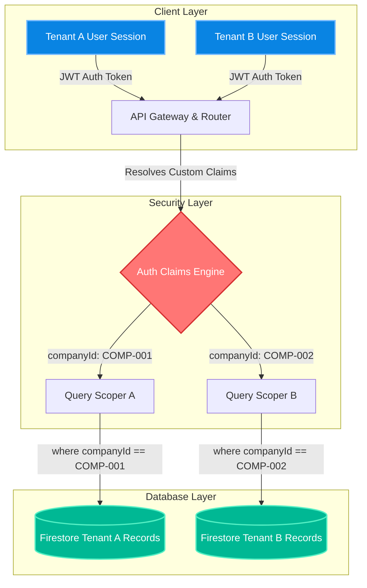

# 🛡️ NEXUS ERP: SYSTEM-WIDE TENANT ISOLATION & DATA SECURITY BLUEPRINT (V3.2 Locked)

This blueprint maps the core security architecture of **NEXUS ERP (Intelligence OS)**. It is designed to satisfy the strict security guidelines of the **Master SOP V3.2**, enforcing bulletproof tenant boundaries, mandatory audit logging, soft-delete mechanisms, and strict Role-Based Access Control (RBAC).

---

## 🏗️ 1. Multi-Tenant Boundary Isolation Architecture

NEXUS ERP employs a hybrid multi-tenancy model to isolate data at the storage layer while optimizing performance and real-time updates.



### A. Core Scoping Patterns
All documents in the system are bound by a double-layered boundary check to ensure no cross-tenant leak can occur:

1. **Global Field Scoping (Root Collections)**:
   Collections like `products`, `users`, and `audit_logs` are kept at the root of the database. Every document contains a `companyId` (camelCase) field. Queries must apply the scoping filter:
   ```typescript
   import { query, collection, where } from "firebase/firestore";
   const q = query(
     collection(db, "products"),
     where("companyId", "==", currentCompanyId),
     where("isDeleted", "==", false)
   );
   ```

2. **Subpath Scoping (Transaction Collections)**:
   Highly sensitive financial and operational documents (e.g. `purchase_orders`, `quotations`, `stock_movements`, `sales_orders`) are stored inside nested sub-collections scoped directly under the specific company document path:
   ```
   /companies/{companyId}/purchase_orders/{poId}
   /companies/{companyId}/quotations/{quotationId}
   /companies/{companyId}/stock_movements/{movementId}
   ```
   This model guarantees that even if a developer omits a `where("companyId")` filter in client-side code, the Firestore engine physically prevents access to other tenants' directories because the query path is explicitly locked to the active user's company context.

---

## 🔐 2. Firestore Security Rules Specifications

`firestore.rules` enforces the multi-tenancy policy at the server level, rendering all client-side alterations harmless.

```javascript
rules_version = '2';
service cloud.firestore {
  match /databases/{database}/documents {
    
    // [GOVERNANCE] Multi-tenant Isolation Rules
    // Binds all access to the companyId found in the user's custom claims
    
    function isSignedIn() {
      return request.auth != null;
    }
    
    function belongsToCompany(companyId) {
      return isSignedIn() && request.auth.token.companyId == companyId;
    }
    
    // Default Rule: Lock everything by default to prevent accidental exposures
    match /{document=**} {
      allow read, write: if false;
    }
    
    // User Profiles: Users can read their own profile, Admins can manage company users
    match /users/{userId} {
      allow read: if isSignedIn() && (request.auth.uid == userId || belongsToCompany(resource.data.companyId));
      allow write: if belongsToCompany(request.resource.data.companyId) && 
                   (request.auth.token.role == 'ADMIN' || request.auth.token.role == 'SUPERADMIN');
    }
    
    // Core ERP Collections (Sales, Inventory, Projects, Finance)
    // ALL operations MUST match the companyId in the auth token
    match /{collectionName}/{docId} {
      allow read, write: if belongsToCompany(resource.data.companyId || request.resource.data.companyId);
      
      // Strict Admin-only Delete Policy (Soft delete enforcement)
      allow delete: if belongsToCompany(resource.data.companyId) && 
                    (request.auth.token.role == 'ADMIN' || request.auth.token.role == 'SUPERADMIN');
    }
    
    // Audit Logs: Write-only for normal operations, Read for Admins, no updates or deletions allowed
    match /audit_logs/{logId} {
      allow create: if isSignedIn() && request.resource.data.companyId == request.auth.token.companyId;
      allow read: if belongsToCompany(resource.data.companyId) && request.auth.token.role == 'ADMIN';
      allow update, delete: if false; // Immutable logs
    }
  }
}
```

---

## 🗑️ 3. Soft Delete Policy & Data Integrity

To maintain strict regulatory compliance and accurate accounting history, hard deletions of structural data are prohibited in NEXUS ERP.

### A. Technical Implementation
Every document model inherits from `BaseDocument` (defined in `database.ts`), which enforces the `isDeleted: boolean` flag.
* **Deletion Action**: Clicking the delete button in the UI triggers an `update` operation setting `isDeleted: true` instead of a database `delete()` call.
* **Retrieval Rule**: All listing queries must prepend the filter `where("isDeleted", "==", false)`.
* **Cascade Safeguard**: If a project is soft-deleted, nested sub-collections (e.g. milestones, task schedules) remain physically intact but are logically closed through parent reference check loops.

### B. Transaction Snapshot Pattern
When commercial transactions are registered (e.g. saving a Purchase Order or Quotation), structural master data such as the customer's legal name, tax ID, and historical unit cost is snapshotted into the transactional record:
```typescript
const quotationItem = {
  productId: item.productId,
  name: item.name,
  qty: item.qty,
  unit: item.unit,
  costWACSnapshot: item.costWAC,  // WAC price snapshotted at time of creation
  pricePerUnit: item.price,
  total: item.qty * item.price
};
```
> [!NOTE]
> This pattern protects transaction history against future modifications of the Master Inventory Catalog. Even if a product's SKU or name is updated or soft-deleted later, the historical quotation maintains its exact figures for audit trail and balance sheet reconciliation.

---

## 📝 4. Immutable Audit Trail Engine

The `audit_logs` collection serves as the immutable ledger tracking all operations (Create, Update, Delete) across the ERP system.

### A. Data Schema Definition
Every audit entry records the exact state changes before and after the operation:
```typescript
export interface AuditLog extends BaseDocument {
  action: 'CREATE' | 'UPDATE' | 'DELETE' | 'LOGIN' | 'EXPORT';
  module: 'SALES' | 'INVENTORY' | 'PROJECTS' | 'FINANCE' | 'SYSTEM';
  targetId: string; // The primary key of the affected document
  reason?: string;  // Required description for sensitive operations
  changes?: {
    before: any;    // JSON state before transaction (null on CREATE)
    after: any;     // JSON state after transaction (null on DELETE)
  };
  metadata: {
    ipAddress?: string;
    userAgent?: string;
  };
}
```

### B. Trigger Implementation Sample
```typescript
import { db } from "@/lib/firebase";
import { doc, getDoc, updateDoc } from "firebase/firestore";

export async function secureUpdateProduct(
  userId: string, 
  companyId: string, 
  productId: string, 
  updates: Partial<Product>,
  reason: string
) {
  const prodRef = doc(db, "products", productId);
  const beforeSnapshot = await getDoc(prodRef);
  const beforeData = beforeSnapshot.data();

  // Enforce company ID check before writing
  if (beforeData?.companyId !== companyId) {
    throw new Error("ACCESS_DENIED: Tenant boundary violation");
  }

  // Update transaction
  await updateDoc(prodRef, {
    ...updates,
    updatedAt: new Date(),
    updatedBy: userId
  });

  // Commit to Immutable Audit Log
  await auditService.logUpdate(userId, companyId, "INVENTORY", productId, beforeData, updates, reason);
}
```

---

## 🛡️ 5. Cyber-Security Threat Lens & Attack Mitigation Matrix

This matrix evaluates potential attack paths and documents our active server-side countermeasures.

| Attack Vector | Threat Description | Attack Path | Mitigation Countermeasure | Status |
| :--- | :--- | :--- | :--- | :---: |
| **Cross-Tenant ID Injection** | An authenticated attacker attempts to query or edit records belonging to another company by modifying `companyId` variables in the JSON payload sent from the client browser. | User changes request parameter from `COMP-A` to `COMP-B` and triggers Firestore fetch. | **Firestore Security Rules**: The rule `belongsToCompany(resource.data.companyId)` blocks the request at the server level because the token's authenticated claim `companyId` (extracted from the secure JWT token) does not match `COMP-B`. | 🔒 Active |
| **Role-Based Privilege Escalation** | A `SALES` or `ENGINEER` user manipulates browser local storage states or modifies javascript variables in memory to trigger restricted administrative functions (e.g. system deletions). | Attackers unlock the delete button by removing the `disabled` html tag in developer tools, triggering `deleteDoc()`. | **Custom Token Claim Gating**: The database delete rules require `request.auth.token.role == 'ADMIN'`. The server validates this against Firebase Auth securely, ignoring any client-side state manipulation. | 🔒 Active |
| **Audit Trail Deletion / Manipulation** | A malicious inside user (e.g. an Accountant attempting fraud) attempts to delete or alter the `changes` history in the `/audit_logs` collection to hide previous transaction figures. | User triggers a deletion or updates target log elements in the audit path. | **Immutable Write-Only Rule**: The rule `allow update, delete: if false;` globally blocks all mutations to existing documents in the `audit_logs` collection, guaranteeing audit trail integrity. | 🔒 Active |

---

## 🧪 6. Security UAT Verification Guide

Follow these validation scenarios to confirm the integrity of the tenant isolation architecture.

### Test Case 1: Cross-Tenant Data Leak Attack Simulation
* **Objective**: Confirm that a user logged into Company A (`COMP-001`) cannot read inventory records belonging to Company B (`COMP-002`).
1. Log into NEXUS ERP with a testing account bound to `companyId: "COMP-001"`.
2. Open the browser's developer console (F12) and attempt to execute a manual Firestore query targeting a known product ID of `COMP-002`:
   ```javascript
   import { getFirestore, doc, getDoc } from "firebase/firestore";
   const db = getFirestore();
   const compromisedDoc = await getDoc(doc(db, "products", "comp-002-sku-999"));
   console.log(compromisedDoc.data());
   ```
3. **Expected Result**: The browser console must throw a Firebase Permission Denied error (`FirebaseError: [code=permission-denied]: Missing or insufficient permissions.`). Confirm that no data payload is returned.

---

### Test Case 2: Unauthorized Delete Attempt Verification
* **Objective**: Ensure that a non-admin account cannot perform deletions of critical ERP records.
1. Log in with an account having the role `ENGINEER` bound to `companyId: "COMP-001"`.
2. Navigate to the **รายละเอียดโครงการ (Project Details)** tab.
3. Verify that the **จัดการโครงการ (Delete Project)** button is visually hidden or disabled for non-admins according to V3.1 specs.
4. Attempt to bypass the UI constraint by executing a delete call directly from the developer console using the project's document ID:
   ```javascript
   import { getFirestore, doc, deleteDoc } from "firebase/firestore";
   const db = getFirestore();
   await deleteDoc(doc(db, "projects", "prj-comp-001-active"));
   ```
5. **Expected Result**: The operation must fail instantly at the database level with a permission-denied error. The project must remain visible and intact in the database.

---

### Test Case 3: Audit Ledger Immutability Verification
* **Objective**: Verify that audit logs cannot be edited or deleted once written.
1. Log into NEXUS ERP with a `SUPERADMIN` credential.
2. Retrieve any audit log ID from the system database.
3. Attempt to run an update or delete query targeting that log document from the console:
   ```javascript
   import { getFirestore, doc, updateDoc } from "firebase/firestore";
   const db = getFirestore();
   await updateDoc(doc(db, "audit_logs", "log-id-12345"), { "changes.after": {} });
   ```
4. **Expected Result**: Confirm that even with `SUPERADMIN` status, the Firestore rule `allow update: if false;` rejects the transaction immediately, guaranteeing data immutability.

---
*Locked under NEXUS ERP V3.2 | Tenant Isolation Standard | Systematic Security Verification Active*
